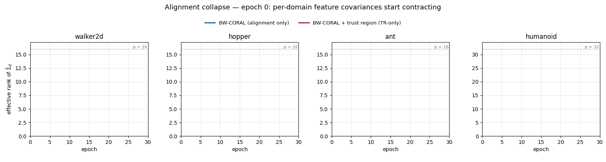
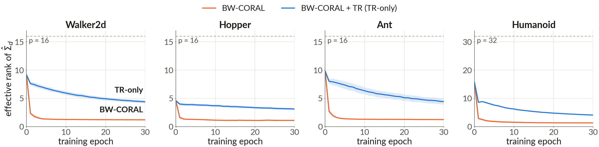
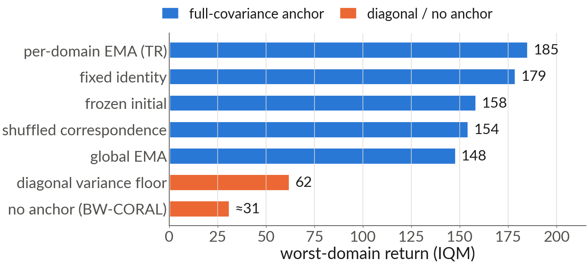
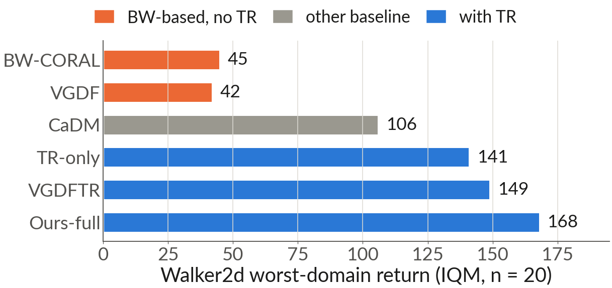
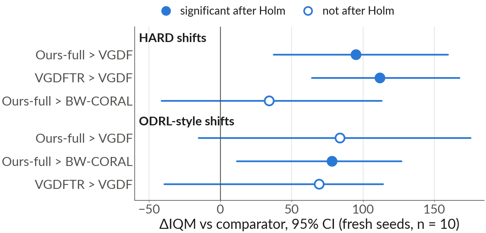
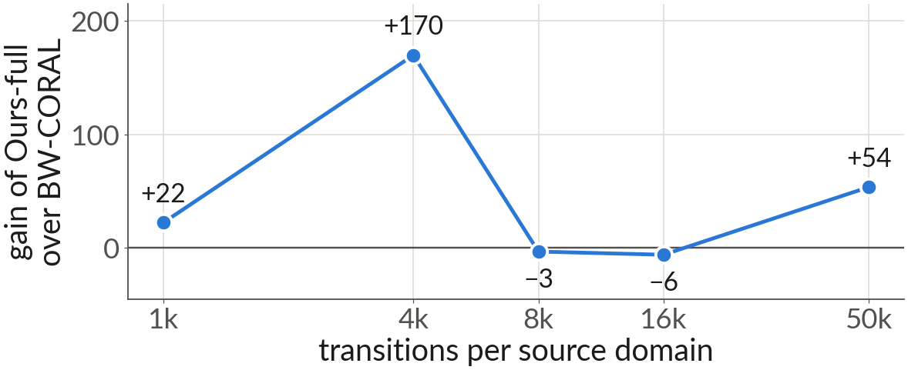
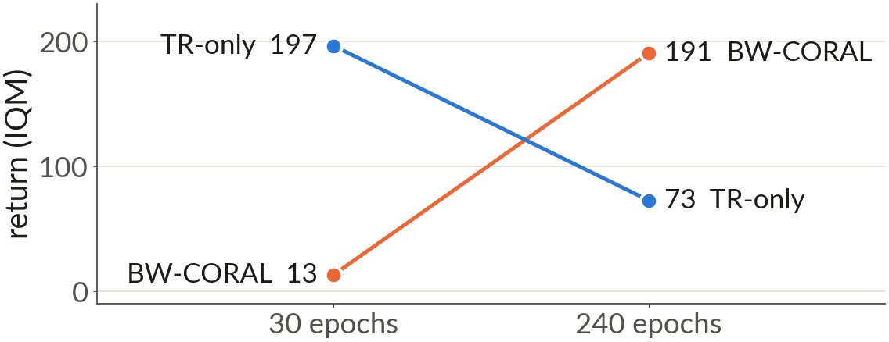

<h1 align="center">Alignment Collapse in Offline Cross-Dynamics Model-Based RL</h1>
<p align="center"><b>A failure mode of inter-domain alignment, and a minimal stabilizer</b></p>
<p align="center">Dong Uk Kim · Ji Su Yoon · Eui-Nam Huh · Choong Seon Hong<br>Kyung Hee University · NeurIPS 2026</p>
<p align="center"><i>Paper: OpenReview link (coming soon)</i></p>

<p align="center">
  
</p>

Cross-dynamics model-based RL often aligns per-domain feature covariances across source dynamics so that a world model transfers to unseen dynamics. In the offline fixed-buffer setting we study, **this alignment collapses the features it acts on**, and a **full-covariance anchor prevents the collapse**. This repository contains the minimal code behind the findings below.

## Findings

### 1 · Alignment collapses the features it acts on

Within a few epochs the per-domain feature covariances contract to a common point: effective rank falls from ≈ 9 (of *p* = 16) to ≈ 1, and the alignment loss reaches zero while transfer regret stays large. The covariance distance that transfer bounds use as a surrogate for dynamics discrepancy then stops tracking it.

<p align="center"></p>

- Mean pairwise BW² between domains drops 0.072 → 0.000 within 5 epochs on Walker2d.
- The collapse appears in our offline implementation of the published method VGDF and in CORAL-style pipelines, across five environments, state and CNN encoders, and every alignment strength we tried.
- BW and Frobenius alignment contract the covariances; MMD alignment degenerates the rank without contracting them.
- All measurements refer to the alignment head feature *u*, not to the planner's latent *z*.

### 2 · Full-covariance anchors prevent it

Six matched-penalty anchors on Walker2d (*n* = 10): all five full-covariance anchors tested avert the collapse, while a diagonal variance floor does not. The instability lives in correlation structure, not scale.

<p align="center"></p>

The **Prototype Trust Region (TR)** is the minimal anchor we use: each domain's covariance is pulled toward its own slow EMA prototype,

$$\bar\Sigma_d \leftarrow \tau\,\bar\Sigma_d + (1-\tau)\,\hat\Sigma_d, \qquad L_{\mathrm{TR}} = \frac{1}{D}\sum_{d} W_2^2\big(\hat\Sigma_d, \bar\Sigma_d\big),$$

with no learnable parameters and one global τ = 0.99 (for *p* ≤ 16). It plugs into BW-based methods (BW-CORAL + TR, VGDF → VGDFTR). Across BW, Frobenius and MMD alignment, worst-domain return goes from 17–45 without TR to 171–198 with it.

### 3 · Where stabilization pays

<table>
<tr>
<td width="50%" valign="top"><br><sub>Walker2d, original seed sets (exploratory comparisons).</sub></td>
<td width="50%" valign="top"><br><sub>Ten seeds never used before, configurations fixed and registered before the runs.</sub></td>
</tr>
</table>

- On untouched seeds all six contrasts reproduce in direction; three remain significant after Holm correction (Ours-full and VGDFTR over VGDF under hard shifts, Ours-full over BW-CORAL under ODRL-style shifts). VGDFTR over VGDF under hard shifts: +112 IQM [+64, +168].
- The Walker2d gain of TR alone (+76 IQM of paired differences on the original seeds) did not reproduce on a fresh seed block (+29, [−70, +150]).

### 4 · It depends on data and training length

<table>
<tr>
<td width="50%" valign="top"></td>
<td width="50%" valign="top"></td>
</tr>
</table>

- Collapse occurs at every data size; its return cost does not. The gain peaks at 4k transitions per domain and vanishes at 8–16k, where BW-CORAL's return recovers while its geometry stays collapsed.
- Every result above uses 30 training epochs. In a 240-epoch run (Walker2d, *n* = 5) TR delayed the collapse but did not prevent it (inter-domain separation reached zero at epochs 41–170), and the return ordering reversed.

### Scope

- Offline fixed buffers and a small controlled testbed (CEM horizon 10 / population 32, 4k transitions per domain, 30 epochs, *p* ≤ 64).
- Tuned VICReg is also effective, and best on Humanoid (IQM 254), but needs per-environment hyperparameters.
- On Hopper every planner scores below a zero-action policy, so Hopper differences are not read as locomotion gains.
- TR adds +51 % / +116 % wall-clock per training step at *p* = 16 / 64.

## Code

The repository is kept minimal: the world model, BW-CORAL alignment, the trust region and its anchor variants, VGDF / VGDFTR, the MuJoCo dynamics shifts, and the scripts below.

```bash
pip install -r requirements.txt
export PYTHONPATH=.
```

**Effective rank during training (Finding 1).** In this script `--method MAIN` adds only the trust region, i.e. BW-CORAL + TR (TR-only).

```bash
python scripts/log_rank_evolution.py --env walker2d --method BASELINE --seed 7 --device cuda:0
python scripts/log_rank_evolution.py --env walker2d --method MAIN     --seed 7 --device cuda:0
# -> checkpoints/RANK_<METHOD>_<env>_seed<S>/rank_history.json
```

**Return comparisons (Findings 2–3).** Each run writes `checkpoints/<PREFIX>[_HARD|_ODRL]_<env>_seed<S>/metrics.json`; `target.worst` is the worst-domain return.

```bash
for s in 7 11 19 23 31; do
  python scripts/run_main.py --config configs/baseline_walker2d.json --seed $s --prefix BASELINE   # BW-CORAL
  python scripts/run_main.py --config configs/abl_E1_walker2d.json   --seed $s --prefix TRONLY     # BW-CORAL + TR
  python scripts/run_main.py --config configs/walker2d.json          --seed $s --prefix MAIN       # Ours-full (TR + score filter + mix-up)
  python scripts/run_vgdf.py    --config configs/walker2d.json --seed $s                          # VGDF
  python scripts/run_vgdf_tr.py --config configs/walker2d.json --seed $s                          # VGDFTR
done
python scripts/paired_stats.py --pair TRONLY_walker2d BASELINE_walker2d --pair VGDFTR_walker2d VGDF_walker2d
```

- Hard or ODRL-style shifts: add `--shift_set hard` or `--shift_set odrl` to any run.
- Anchor variants (Finding 2): `configs/anchor_{global,shuffled,frozen,identity,varfloor}_walker2d.json` with `run_main.py`.
- Other environments: `configs/{baseline_,abl_E1_,}{hopper,ant,halfcheetah,humanoid}.json` (where present).
- `aggregate.py --env walker2d --prefix TRONLY` summarizes one family (mean ± std and IQM over seeds).
- `paired_stats.py` reports the IQM of per-seed paired differences, a 95% bootstrap interval, the one-sided bootstrap p-value, wins, and Holm-adjusted p-values across the listed pairs.

A 30-epoch Walker2d run takes about 5 minutes on one RTX A6000.